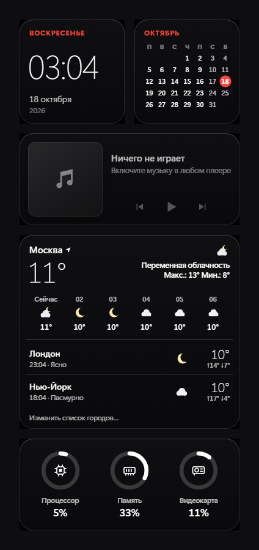

<div align="center">


# Win11Widget

**Виджеты рабочего стола для Windows 11 в стиле macOS**

Часы · Календарь · Сейчас играет · Погода · Система

[](../../actions/workflows/build.yml)


[**Скачать**](../../releases/latest) · [Возможности](#возможности) · [Сборка из исходников](#сборка-из-исходников) · [English](#english)



</div>

## Возможности

| Виджет | Что показывает |
|---|---|
| **Часы** | Время, день недели, дата |
| **Календарь** | Месяц, неделя с понедельника, сегодняшний день отмечен |
| **Сейчас играет** | Обложка, трек, исполнитель, прогресс и кнопки ⏮ ⏯ ⏭ для любого плеера: Spotify, Яндекс Музыка, YouTube в браузере, VLC и др. |
| **Погода** | Основной город с прогнозом на 6 часов и список других городов с местным временем. Клик по городу делает его основным |
| **Система** | Компактно: кольца процессора, памяти и видеокарты. При наведении раскрывается полная версия: модель CPU, ОЗУ, GPU с температурой и VRAM, сеть, время работы, все диски |

Кроме того:

- **Эффект стекла** — под каждым виджетом размытый фрагмент ваших обоев, скругление 22 px.
- **Живут на рабочем столе** — не перекрывают окна, не пропадают по Win+D, нет в панели задач и Alt+Tab.
- **Сетка** — одинаковые отступы 16 px; при перетаскивании виджет примагничивается к соседям и краям экрана; если виджет меняет высоту, нижние сдвигаются следом.
- **Иконка в трее** — включение и выключение виджетов, список городов, автозапуск, «Расставить заново».
- **Лёгкий** — установщик около 1,2 МБ, без фоновых служб и сторонних драйверов.

## Установка

1. Скачайте `Win11Widget_x.y.z_x64-setup.exe` со страницы [Releases](../../releases/latest).
2. Запустите. Права администратора не нужны — установка в профиль пользователя.
3. Виджеты появятся у правого края экрана, иконка — в трее.

> Установщик не подписан цифровой подписью, поэтому SmartScreen может показать предупреждение: «Подробнее» → «Выполнить в любом случае».

Требуется Windows 10 1809+ или Windows 11 с WebView2 Runtime (в Windows 11 уже есть).

## Использование

- **Перетаскивание** — за любое место виджета; позиция запоминается.
- **Правый клик по виджету** — скрыть виджет, «Города…», «Обновить», «Расставить заново», «Выход».
- **Города** — поиск на любом языке, ★ отмечает основной город, порядок меняется стрелками.
- **Автозапуск** — меню трея → «Запускать вместе с Windows».

## Как это устроено

| Задача | Решение |
|---|---|
| Окна виджетов | [Tauri 2](https://tauri.app) + WebView2, прозрачные окна без рамки, владелец — окно рабочего стола (`Progman`) |
| Интерфейс | HTML, CSS и JavaScript без фреймворков |
| Погода и поиск городов | [Open-Meteo](https://open-meteo.com) — бесплатно, без ключа |
| Сейчас играет | Windows `GlobalSystemMediaTransportControls` (тот же источник, что у системной панели громкости) |
| CPU, память, сеть, диски | [`sysinfo`](https://crates.io/crates/sysinfo) |
| Видеокарта | NVIDIA NVML через [`nvml-wrapper`](https://crates.io/crates/nvml-wrapper) |
| «Стекло» | Обои рабочего стола читаются один раз, кэшируются и размываются на `<canvas>` ровно под окном |

```
src/                  интерфейс (по одному окну на виджет)
  widget.html|js|css  все виджеты; тип выбирается параметром ?w=
  weather.js          Open-Meteo и SVG-иконки погоды
  cities.html|js      окно редактирования городов
src-tauri/src/
  lib.rs              окна, трей, настройки, команды
  layout.rs           сетка, примагничивание, раскрытие «Системы»
  system.rs           CPU, RAM, GPU, сеть, диски
  media.rs            «Сейчас играет»
  platform.rs         Win32: привязка к рабочему столу, путь к обоям
```

Настройки хранятся в `%APPDATA%\com.win11widget.desktop\settings.json`.

## Конфиденциальность

Приложение ничего не собирает и не отправляет, кроме запросов погоды и поиска городов в Open-Meteo (в запросе только координаты выбранных городов или поисковая строка). Телеметрии нет.

## Ограничения

- Только Windows.
- Данные видеокарты — только NVIDIA; для AMD и Intel вместо третьего кольца показывается диск C.
- Температура процессора не показывается: в Windows она доступна только через драйвер с правами администратора.

## Сборка из исходников

Нужны [Rust](https://rustup.rs) (stable), [Visual Studio Build Tools](https://visualstudio.microsoft.com/visual-cpp-build-tools/) с компонентом «Разработка классических приложений на C++» и [Node.js](https://nodejs.org) 20+.

```bash
git clone https://github.com/bekilife/Win11Widget.git
cd Win11Widget
npm ci
npm run dev      # запуск в режиме разработки
npm run build    # установщик: src-tauri/target/release/bundle/nsis/
```

Проверки, которые выполняет CI:

```bash
cd src-tauri
cargo fmt --check
cargo clippy -- -D warnings
```

## Лицензия

[MIT](LICENSE)

---

## English

**Win11Widget** brings macOS-style desktop widgets to Windows 11: clock, calendar, now playing, weather (Open-Meteo, no API key) and a system monitor (CPU, RAM, NVIDIA GPU with temperature, network, all drives). Widgets live on the desktop layer with a frosted-glass look, snap to an even 16 px grid and are managed from the tray. Built with Tauri 2, Rust and plain JavaScript; the installer is about 1.2 MB.

Download the installer from [Releases](../../releases/latest), or build it yourself with `npm ci && npm run build`. The UI is in Russian.
